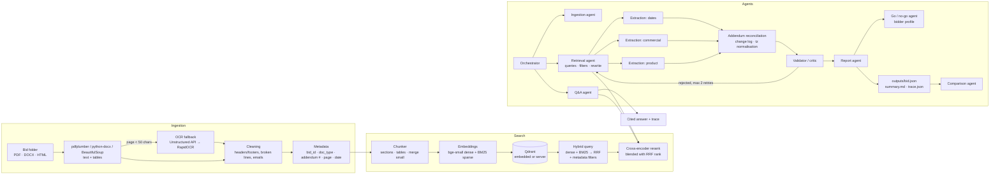

# RFP Intelligence Platform

Turns a folder of public-procurement bid documents (PDF, Word, saved HTML bid pages) into a searchable index
and a structured, cited record. A hybrid RAG search engine (dense + BM25 + RRF + cross-encoder) is the only way
the LLM agents see the documents; every value and answer carries file + page citations, and anything the
documents do not state is returned as **"Not found in documents"**.

```bash
python main.py --bid ./data/bids/Bid1          # index + multi-agent extraction -> outputs/Bid1.json
python main.py --ask "What is the deadline after all addendums?" --bid-id Bid1
python main.py --ask "Compare the warranties of both bids."
python main.py --go-no-go Bid2                  # GO / NO-GO for the bidder in config/bidder_profile.json
python main.py --compare Bid1 Bid2              # field-by-field comparison
python main.py --serve                          # REST API: /index /search /ask /extract
streamlit run ui/app.py                         # web UI: extract, search, ask, evaluation
docker compose up --build                       # API :8000 + UI :8501 + Qdrant server :6333
```

## Setup

Python 3.10+.

```bash
python -m venv .venv && .venv\Scripts\activate      # Windows (source .venv/bin/activate elsewhere)
pip install -e ".[ocr,dev,ui]"
copy .env.example .env                              # then set LLM_API_KEY (cp on macOS/Linux)
```

| Setting (`.env`) | Needed for | Default |
|---|---|---|
| `LLM_API_KEY` | extraction, Q&A | none: required for agents. Free key at console.groq.com |
| `LLM_BASE_URL`, `LLM_MODEL`, `LLM_FAST_MODEL` | any OpenAI-compatible provider | Groq, `openai/gpt-oss-120b`, `openai/gpt-oss-20b` |
| `UNSTRUCTURED_API_KEY` | OCR of scanned pages via Unstructured Transform API | unset → local RapidOCR |
| `QDRANT_URL`, `QDRANT_API_KEY` | remote vector store (Docker / Qdrant Cloud) | unset → embedded Qdrant in `data/qdrant` |

Indexing and search need **no API key**: embeddings, BM25 and the re-ranker run locally (fastembed / ONNX,
~150 MB of models downloaded on first use). Embedded Qdrant locks its folder to one process: stop the API
before running the CLI, or point both at a Qdrant server with `QDRANT_URL`.

## Commands

| Command | What it does |
|---|---|
| `python main.py --bid <folder>` | Incremental index of the folder, then extraction → `outputs/<bid>.json`, `_summary.md`, `_trace.json` |
| `python main.py --bid <folder> --index-only` | Index only. Unchanged files are skipped (content hash) |
| `python main.py --search "<q>" [--bid-id B] [--doc-type T]` | Hybrid search with citations |
| `python main.py --ask "<q>" [--bid-id B]` | Q&A mode: cited answer + agent trace (all indexed bids when no `--bid-id`) |
| `python main.py --go-no-go <bid>` | Go/no-go verdict, fit score and reasons for the bidder in `config/bidder_profile.json`; written into `outputs/<bid>.json` and its summary (also runs at the end of every extraction) |
| `python main.py --compare <bid> <bid> ...` | Field-by-field comparison of saved extractions → `outputs/comparison_<A>_vs_<B>.md` / `.json` |
| `python main.py --serve` | FastAPI on :8000. `POST /index`, `/search`, `/ask`, `/extract`, `/go-no-go/{bid}`, `/compare`; docs at `/docs` |
| `streamlit run ui/app.py` | Web UI: run extraction and browse fields / changes / trace, search with filters, ask questions with citations, evaluation report |
| `docker compose up --build` | API, UI and a Qdrant server in containers (needs `.env`); models are baked into the image |
| `python -m eval.run_eval` | Retrieval evaluation → `eval/report.md` |
| `python -m eval.qa_log` | 12-question Q&A log → `outputs/qa_log.md` |
| `pytest` (`pytest -m "not slow"` skips model-loading tests) | 34 unit tests: parsing, cleaning, dates, chunking, search |

The bid folder name is the `bid_id`. A new, unseen folder needs no code changes.

## Docker and CI

`Dockerfile` builds one image (Python 3.11, local models pre-downloaded) used by both the API and the UI;
`docker-compose.yml` adds a Qdrant v1.20 server so the API and UI can share the index (embedded Qdrant allows
one process). `data/` and `outputs/` are mounted from the host. GitHub Actions (`.github/workflows/ci.yml`)
runs the full test suite on every push (models cached between runs), then builds the Docker image.

## Architecture



**Extraction mode:** the orchestrator indexes the folder, then runs the three extraction groups in parallel.
Each field is retrieved by the retrieval agent (field queries over the bid, plus filtered passes on the bid page,
specs or addenda), then extracted by its group's agent. The reconciliation agent reads every addendum (newest
first) and applies changes, logging old → new values with sources; date fields are normalised in code. The
validator checks each value against the text it cites; rejected fields go back to retrieval with rewritten
queries and the rejection reason, at most twice. The report agent writes the summary and output files.

**Decision agents** work from the validated records, not raw documents. The go/no-go agent judges fit against
an editable bidder profile (`config/bidder_profile.json`: manufacturers, services, capacity, bid bond limit,
registrations) and returns GO / NO-GO / REVIEW, a 0-100 fit score, pro / con / risk reasons tied to fields, and
questions to ask the buyer; whether the deadline has passed is computed separately in code. The comparison
agent compares two or more bids field by field.

**Q&A mode:** the orchestrator plans which bids to search (all indexed bids when none is given, so comparisons
get evidence from each), the Q&A agent retrieves per bid plus that bid's addenda and answers only from them.

All agent messages are Pydantic models (`agents/state.py`); the shared `BidState` holds fields, evidence,
change log, counts and the trace. Every step is timed and recorded in the trace and `logs/rfp.jsonl`.

## Output record

`outputs/<bid>.json` has the 20 fields (Bid Number, Title, Due Date, Submission Type, Term, Pre-Bid Meeting,
Installation, Bid Bond, Delivery Date, Payment Terms, Required Documents, MFG Registration, Cooperative Contract,
Model_no, Part_no, Product, Contact, Company, Summary, Product Specs). Each field:

```json
"Due Date": {
  "value": "July 9, 2024 at 2:00 PM CST",
  "sources": [{"file": "Addendum 2 RFP JA-207652 Student and Staff Computing Devices.pdf", "page": 1}],
  "confidence": 0.95,
  "notes": "Addendum 2 extends the original due date | CST written during daylight saving time; interpreted as CDT (UTC-5)",
  "status": "accepted",
  "normalized": "2024-07-09T14:00:00-05:00"
}
```

plus `addendum_changes` (field, old value, new value, addendum number, source), `validation` (accepted /
rejected / not found / retries), `go_no_go` (verdict, score, deadline status, reasons) and `llm_usage`
(calls, cached calls, tokens).

## Retrieval evaluation

21 questions over both bids with gold (file, page) passages (`eval/questions.json`); full table and per-question
ranks in [`eval/report.md`](eval/report.md).

| Config | R@1 | R@5 | MRR |
|---|---|---|---|
| vector only | 0.62 | 0.86 | 0.73 |
| BM25 only | 0.71 | 0.90 | 0.79 |
| hybrid (RRF) | 0.67 | 0.90 | 0.77 |
| hybrid + rerank | **0.81** | 0.90 | **0.85** |

Vector-only misses exact identifiers (part `210-BLYZ`); BM25 misses paraphrases; hybrid + rerank ranks the
right passage first most often. The reranker costs ~2 s/query on CPU.

## Design decisions

- **pdfplumber first, OCR only where needed.** All but 6 of 79 PDF pages have a text layer. Pages under 50
  characters (a W-9 drawn as vector shapes in Bid1) are sent, together in one request, to the Unstructured
  Transform API, or OCR'd locally with RapidOCR when no key is set. Pages are tagged with how they were read.
- **Form tables are text, not tables.** Government forms come out of pdfplumber as wide grids of mostly empty
  cells; indexing them as Markdown tables duplicated the page text and hurt reranking, so they are skipped as
  tables (their text is already in the page). Real grids (price schedules) stay Markdown tables.
- **Qdrant for both local and remote.** Same client code embedded (no server) or against Docker / Qdrant Cloud.
  Dense and sparse vectors live on the same point; Qdrant computes BM25 IDF server-side, so adding a bid
  never requires rebuilding the keyword index.
- **Local embeddings and reranker.** Searching never needs an API key, and reviewers can index unseen bids
  offline. IDs like `JA-207652` are also indexed joined (`ja207652`) because BM25 splits on hyphens.
- **Incremental indexing.** Chunk ids are derived from (bid, file hash, page, index): re-runs skip files whose
  hash is already indexed, changed files replace their old chunks, `delete_bid` removes one bid.
- **Rerank blends instead of replaces.** The small cross-encoder does not know "Agency POC" means "procurement
  officer"; fusing its order with the hybrid order (RRF) raised MRR from 0.81 to 0.85 and stopped it burying
  good hits.
- **Dates are normalised in code, not by the LLM.** The model converted "2:00 PM CST" on July 9 to UTC-6; the
  correct offset is UTC-5 (daylight time). `agents/timeutil.py` applies US DST rules.
- **Addenda newest first.** Reconciliation reads addenda in descending number, so the latest change wins and is
  never cut off by the prompt size cap.
- **Free-tier LLM limits shape the agents.** Groq's free tier allows 8,000 tokens/minute on `gpt-oss-120b`:
  prompts are capped (4 fields per call, 5 sources of 700 characters), the validator and query rewriting run on
  `gpt-oss-20b` (separate quota), retries honour `Retry-After`, oversized requests are not retried, and every
  response is cached on disk (`data/llm_cache/`) so re-runs cost nothing.
- **Failures degrade, not crash.** Unreadable files are logged and skipped; unsupported files (`.doc`, `.xlsx`)
  are listed in the log; an LLM failure leaves the affected fields "Not found" with a note and the run continues.

## Known limitations

- Bid1 contact: the buyer's name appears only in the RFP's running header, which ranks low; the extracted
  contact has the procurement phone and email but no name.
- Required documents is the least reliable field: the model sometimes lists forms mentioned inside other forms'
  instructions (Bid1) or does not treat bundled affidavits as required (Bid2). A larger model should help.
- LLM output varies slightly between runs when prompts change; cached runs are reproducible.
- `doc_type` comes from file names and first-page text; an unusually named file may be typed `other`. It is
  still indexed and searchable, but doc-type filters will not select it.

## Project layout

```
core/        config (env / .env), Pydantic models, JSON logging
ingestion/   PDF / DOCX / HTML parsers, OCR fallback, cleaning, classification, cached pipeline
search/      chunking, local models, Qdrant store, incremental indexer, hybrid search engine
agents/      LLM client, state + messages, orchestrator and agents, field specs, date normalisation
api/         FastAPI app
eval/        retrieval evaluation, Q&A log
tests/       pytest suite
docs/        build plan
outputs/     generated JSON records, summaries, traces, Q&A log
```
